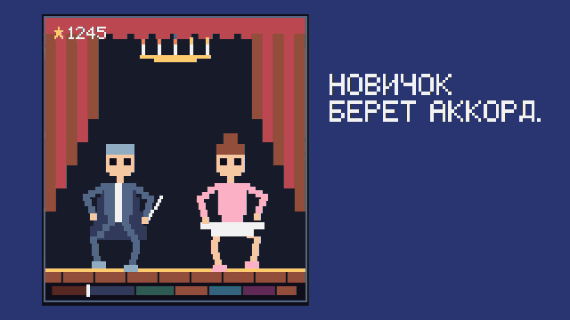

# Void to Rockstar

**English** | [Русский](README.ru.md)

[](docs/smk-trainer-promo.mp4)

The whole film with sound: [docs/smk-trainer-promo.mp4](docs/smk-trainer-promo.mp4), 37 seconds. Its titles are in Russian.

**SMK Trainer will teach anyone to play.** You have never touched a keyboard, you have no ear, no time, and it is too late to start: the void has heard all of this before and does not object. The trainer takes you from the first note to a track of your own. Who walks on stage after that is up to you.

**SMK Trainer** is a Max for Live device. It sits on a track in Ableton Live, hears every note and teaches the keys from zero: it shows which key to press, suggests the chord, sets tasks you can manage and judges your playing honestly, from cacophony to the rank of a virtuoso.

- **1061 lessons on 40 levels**: from the first note to polyphony, the circle of fifths and a finished track.
- **Free play in 67 styles**: classical, house, techno, drum and bass, jazz, soul, jazz-rock and their kin. Every style has a scenery of its own, two dancers of its own, and advice on how to play it and how to make its sound.
- **A coach and advice**: 27 tasks in free play, and one piece of advice at a time that looks both at your hands and at the project in Ableton.
- **A verdict on your playing**: a gauge from noise up to two ranks above "cosmos". A combo earns points, cacophony costs them.

> The trainer speaks Russian and English. Pick RU or EN in the bottom left corner of its right-hand panel; the choice is remembered.

The trainer is written for the M-Vave SMK-37 Elite MIDI keyboard (the Movetone version) and Ableton Live 12. The playing lessons listen to plain MIDI notes but have not been tried on other keyboards; the knob and pad numbers in the lessons on sound are those of the SMK-37. Next to the trainer the kit holds what this keyboard needs on Windows: a Bluetooth connection and a mapping of its controls.

## What is in the kit

| What | Where | What for |
|---|---|---|
| Bluetooth MIDI guide | [SMK-37-Bluetooth-MIDI.en.md](SMK-37-Bluetooth-MIDI.en.md) | Connect the keyboard without a cable through loopMIDI and MIDIberry |
| Bridge starter | [bridge](bridge) | One click brings the bridge up and checks it: the loopMIDI port, MIDIberry, and that a note from the keyboard reaches the port |
| Keyboard script for Ableton | [ableton/SMK37](ableton/SMK37) | Encoders, faders and pads control Ableton at once |
| SMK Trainer | [trainer](trainer) | Learn to play and to use Ableton, inside Ableton |

Installation is described in [INSTALL.en.md](INSTALL.en.md).

## The keyboard script

A Control Surface for Ableton Live:

- encoders K1-K8 turn the eight main parameters of the selected device: the set comes from Ableton's own table, and for devices it lacks (Drift, Delay, Chorus-Ensemble, Auto Filter, Redux, Limiter and others) from the `EXTRA_BANKS` table in the script;
- faders 1-4 set the volume of tracks 1-4;
- the 16 pads play the 16 visible pads of a Drum Rack;
- the keys and the Mod wheel are moved to MIDI channel 4, where Pitch already is, so the keys track listens to one channel and the pads (channel 9) go to their own track.

The controller and note numbers were measured on one keyboard. Another unit or firmware may differ; they are all constants at the top of [SMK37.py](ableton/SMK37/SMK37.py).

## The trainer

A Max for Live device (a MIDI effect) that goes on the keys track. It needs Ableton Live Suite, or Max for Live bought separately.

- **One path**: 40 levels, 1061 lessons, from the first notes to polyphony, the circle of fifths and a finished track. Playing alternates with sound design and with Ableton itself. The order is the `PATH` list in [smk_trainer.js](trainer/smk_trainer.js).
- **Short levels** introduce a subject in 5 to 15 lessons; **long ones** drill one skill in 40: notes, black keys, intervals, chords, progressions, inversions, bass with a chord, two hands, keys, seventh chords, scales, beats, synth knobs, effects, genre tempos, Live's synths, the sequencer, composition, the methods of four artists, rare chords, chromatics, polyphony.
- **Live's synths**: Analog, Operator, Wavetable, Meld, Electric, Collision, Tension and Simpler, then one sound on different synths and layers of two and three instruments in a Rack.
- **The sequencer**: clip and grid, pitch, length and force of notes, syncopation, triplets and quantisation, bass, chords and melody drawn with the mouse, variations, Live 12 generators, scenes, recording a loop in layers and step by step. The trainer reads the notes of the open clip.
- **Composition**: parts of a track as scenes, recording scenes to the arrangement, locators, the loop, cutting and inserting time, build-ups and drops, transitions, the form of house, techno, trap, drum and bass and lo-fi, checking the length, saving and exporting.
- **As the masters do**: 40 lessons on the sound and composition of Globular, Soulacybin, Symbolico and The Algorithm. The lesson texts hold only what the artists or their labels have said themselves; where nothing about their instruments could be found, the lesson teaches the methods of the genre and says so.
- **Rare chords, chromatics, polyphony**: three courses of 40 lessons. The trainer recognises 29 kinds of chord and names them by the lowest note.
- **Free play**: not a lesson but a place for your own music. Pick one of 67 styles and one of 18 moods (modes). The circle and the keys show the notes of the chord that sounds now, the rest of the scale, the colour note of the mode and what is outside it. Every style has its own scenery and its own pair of dancers with a dance of their own: 134 characters and 67 dances. They dance on the beat: of Ableton's song while it plays, otherwise of the pulse the player keeps, otherwise at the tempo of the style.
- **The coach of free play**: 27 tasks one after another, in the mode and from the tonic on the circle: find the tonic, play the chord notes, a scale up and down, hold the rhythm, repeat a motif, end a phrase on the tonic, thirds, three chords of the mode, a melody over a chord, a cadence, and on up to the ranks.
- **Advice for the moment**: two columns under the keys. On the right the coach's task, always in sight. On the left one piece of advice, the one that is needed now: about the playing while the keys sound (notes outside the mode, a stumbling rhythm, a melody that circles on two notes, the same chord again, no left hand), about the track while they rest (the sound of a part, the next step, the stage, the form of the track). It freezes under the cursor so it can be read.
- **The verdict**: a gauge of seven stretches under the stage: noise, silence, dance, fire, cosmos and two ranks above it, virtuoso and legend. The ranks are given only for playing that is steady, varied, wide, rich in chords, two-handed, fast and clean at once. Random strokes without rhythm sink into cacophony even when every note is in the scale.
- **Copies on several tracks** act as one trainer: the lesson, the step, the style and the points are shared, and notes played into any track with a copy are shown and judged by the copy on the screen. Pads on a drum track count for their rhythm in free play.
- **A look at the project**: in free play the trainer reads the Live Set (devices, track names, clip notes, scenes, the arrangement, the tempo) and says what the track lacks by the measure of the chosen style.
- **Drills**: 14 lessons that give a new task of the same kind on every run.
- **Synths, effects, drums on the pads, Ableton methods, genres**: filter, envelope, oscillators and LFO on Drift; Reverb, Delay, Auto Filter, Saturator, EQ Eight, Compressor, sends and returns; rock, house, hip-hop, trap and breakbeat on the pads; templates, Capture MIDI, automation, Racks and macros, sidechain, export; a "passport" and a beat for fifteen genres.
- **Missions in Ableton**: the trainer sees what has been done through the Live API: which device is on the track, which way a knob was turned, what the tempo is. If a check fails, the step can be confirmed with the "Done" button.
- **Points** for a lesson, for playing without mistakes and for an even rhythm. They are saved in a file next to the device and open new levels.
- **Two languages**: Russian and English. The lessons, the tips, the coach and every label are translated; the language is chosen on the panel and kept in the save file. The texts live in [trainer/lang](trainer/lang) and are packed into `lang_en.js` by `make_lang.py`.
- **The stage** answers the playing: music that holds together starts the dancing, the fireworks and "cosmos", cacophony calls a thunderstorm.

The trainer checks the notes and the order of the strokes. It does not check whether a stroke lands on the beat; it measures how even the time between steps is.

### How the code is built

Everything is drawn with filled rectangles in a fixed palette, the text included, so the picture can be rendered outside Max too.

| File | Purpose |
|---|---|
| [smk_trainer.js](trainer/smk_trainer.js) | Logic, lessons and drawing. Runs in a `jsui` object, ES5 only |
| [lang_en.js](trainer/lang_en.js), [lang_en_rules.js](trainer/lang_en_rules.js) | English: the table of texts (made by `lang/make_lang.py`) and the rules for lines built from pieces |
| [lang](trainer/lang) | The Russian texts and their English, the brief for translators, the checks |
| [sprites_data.js](trainer/sprites_data.js) | Animation frames, generated |
| [export_sprites.mjs](trainer/export_sprites.mjs) | Bakes the frames from pixelfx effects |
| [build.py](trainer/build.py) | Builds `SMK Trainer.amxd` from Ableton's factory template |
| [test_trainer.js](trainer/test_trainer.js) | Plays every lesson without Ableton and checks knob names against the table |
| [live_parameters.py](trainer/live_parameters.py) | Reads the knob names of every device from the installed Ableton into `live_parameters.json` |
| [preview.mjs](trainer/preview.mjs) | Renders states of the trainer to PNG without Ableton |

### Commands

Check the logic:

```bash
node trainer/test_trainer.js
```

The same with the English screen: it also lists every line that has no English or does not fit its place:

```bash
SMK_LANG=en node trainer/test_trainer.js
```

Build the device into Ableton's User Library (an open device reloads itself):

```bash
py trainer/build.py
```

Render a preview, scale 2:

```bash
node trainer/preview.mjs preview.png 2
```

Pack a release archive into `dist/`:

```bash
py release.py 0.10.0
```

The self-check in a real Ableton and the remaining details are described in [README.ru.md](README.ru.md).

## Licence

The kit is under the [PolyForm Noncommercial License 1.0.0](LICENSE.md): installing it, playing, changing the code and building noncommercial projects on it is free. Any use for revenue needs a separate licence from the author for a share of that revenue: see [COMMERCIAL.md](COMMERCIAL.md).

## Third-party code and material

The animations of characters and effects are baked from the [pixelfx](https://github.com/patch-gg/pixelfx) library (MIT licence). Its text is in [THIRD_PARTY_NOTICES.md](THIRD_PARTY_NOTICES.md).

MidiSuite, the keyboard maker's own program, is not part of the repository.
